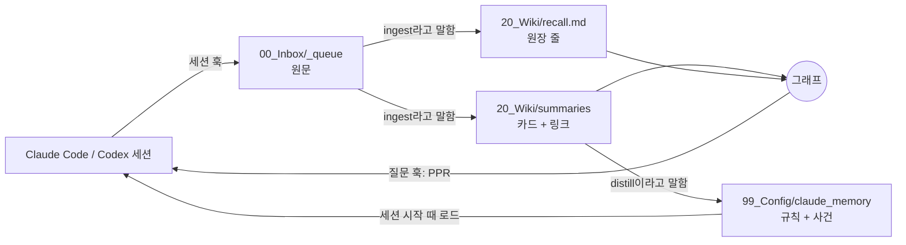

# Madeleine

**Claude Code를 위한 연상 기억.** 나눈 대화를 저장하고, 카드로 정리하고, 서로 이어 그래프로 만든다. 질문을 칠 때마다 훅이 그 질문이 건드리는 과거 대화를 찾아 Claude 앞에 놓는다. 임베딩 API도, 벡터 DB도, 서버도 없다. 마크다운 파일과 git, 파이썬 표준 라이브러리로 돈다. 선택 사항인 학습 모델은 내 대화로 내 컴퓨터에서 학습하고, 학습할 때만 numpy와 scipy가 필요하다.

[English](README.md)

이름은 프루스트에서 왔다. 《잃어버린 시간을 찾아서》에서 화자는 홍차에 적신 마들렌을 먹는 순간, 떠올리려 애쓰지 않은 어린 시절을 통째로 떠올린다. 이 시스템에서도 기억을 검색하지 않는다. 지금 나누는 대화가 과거 기억을 불러온다.

## 실제 모습

지어낸 대화 6개와 아직 정리하지 않은 대화 2개로 만든 시연용 vault에서 뽑은 실제 출력이다. 이렇게 묻는다.

> the basil is going black again, should I change how often I water it?

Claude가 답하기 전에 훅이 다음 내용을 문맥에 넣는다.

```
Recalled memories (injected automatically: conversations not yet ingested that overlap this prompt, then past conversations it touches. Each line is a memory that came to mind. [keyword], [model] and [raw] name the method that brought the line up. Keep them in the background; open the path or [[link]] when you need detail. If you Read a summary, run recall_ppr.py learn):
- (not ingested) 2026-08-02 pruning the tomatoes — "The tomato plants are taller than me. Should I cut the top?" · "And should I water less in August?" → 00_Inbox/_queue/2026-08-02_pruning_the_tomatoes__thread.md
- [keyword] 2026-03-20 [[2026-03-20_drip_timer_broke_basil_rot__summary|The drip timer broke and the basil started rotting]] — timer battery · overwatering · root rot · "the soil never dries out"
- [keyword] 2026-03-02 [[2026-03-02_balcony_vegetable_garden_plan__summary|Planning a vegetable garden on the balcony]] — tomato planters · south-facing balcony · drip irrigation · "too much shade by 3pm" · seed swap
- [keyword] 2026-06-01 [[2026-06-01_essay_why_i_garden__summary|Drafting an essay on why I garden]] — patience · "nothing happens for weeks" · first essay draft
- [keyword] 2026-07-15 [[2026-07-15_moving_to_a_north_facing_flat__summary|Deciding whether to move to a north-facing flat]] — lease renewal · north-facing windows · "I'd lose the balcony"
- [raw] 2026-05-08 [[2026-05-08_sourdough_starter_revival__summary|Reviving a sourdough starter after two weeks away]] — you said: "It doubled again on the second day." → 00_Inbox/_processed/2026-05-08_sourdough_starter_revival__thread.md:21
- [raw] 2026-04-11 [[2026-04-11_library_seed_swap__summary|Trading seeds at the library seed swap]] — you said: "The seed swap at the library was busy. The rule was take three, bring three." → 00_Inbox/_processed/2026-04-11_library_seed_swap__thread.md:13
```


첫 줄은 아직 정리하지 않은 대화로, 질문과 "water"라는 단어가 겹친다. 정원을 가꾸는 이유를 쓴 글 카드는 질문과 겹치는 단어가 하나도 없다. 베란다 텃밭 카드와 이어진 링크를 타고 올라왔다. `[raw]` 줄은 원문을 비교해 찾았고, 그 말을 한 원문 줄을 가리킨다. 학습 모델을 학습시키면 `[keyword]`가 두 줄로 줄고 `[model]`이 두 줄을 낸다.

## 다른 기억 시스템과 다른 점

- **검색이 아니라 연상이다.** 대화 카드, 카드에 나온 사람·장소·프로젝트, 카드 사이 링크로 그래프를 만들고 그 위에서 개인화 페이지랭크(PPR, 활성 확산)를 돌린다. 방식은 [HippoRAG](https://arxiv.org/abs/2405.14831)를 따랐다.
- **Claude가 파일을 직접 읽는다.** 카드는 YAML 머리말이고, Claude가 열어 읽고 링크를 따라간다. 모든 기억이 직접 읽고 고칠 수 있는 파일이다.
- **세 가지 방법으로 떠올린다.** `[keyword]`는 그래프 위에서 활성을 퍼뜨린다. `[raw]`는 내가 실제로 한 말을 글자 조각으로 비교한다. `[model]`은 내 대화로 학습한 벡터를 쓴다. 같은 대화의 쌍과 내가 손으로 이은 카드를 가깝게 배운다. 떠올리는 일은 파이썬 표준 라이브러리로 돈다. 학습은 선택 사항이고 numpy와 scipy가 필요하다. 학습하기 전에는 `[keyword]`가 모델 자리를 채운다.
- **실제로 쓰인 기억이 강해진다.** Claude가 떠오른 카드를 실제로 읽으면 그 카드로 이어진 연결이 굵어진다(헵 학습, 반감기 90일). 떠오르기만 하고 읽히지 않은 카드는 아무것도 얻지 않는다.
- **마음층을 따로 둔다.** Claude가 나와 일하는 방식을 정하는 파일은 두 가지다. 하나는 Claude가 반드시 지킬 행동 규칙이고, 다른 하나는 내가 무언가를 결정한 순간을 말 그대로 인용해 모은 `episodes.md`다. 내가 어떻게 생각하는지는 규칙으로 적지 않는다. Claude가 사건을 읽고 그때그때 판단한다.

## 작동 방식



1. **캡처.** 세션 훅이 모든 세션을 마크다운 원문으로 `00_Inbox/_queue/`에 저장한다. 도구 호출과 시스템 문구는 빼고, 내 말과 Claude의 답만 남긴다.
2. **정리.** `ingest`라고 말하면 Claude가 원문을 읽고 세 가지를 쓴다.
   - 카드: 주장, 정정, 남은 질문, 등장한 개체, 결정적 순간
   - `20_Wiki/recall.md`의 원장 한 줄: 나중에 이 대화를 다시 불러올 단어들
   - 관련된 과거 카드로 가는 링크
3. **연상.** 질문마다 `recall_ppr.py hook`이 원장 단어, 개체 별칭, 모든 원문의 본문에서 출발점을 잡고 PPR을 돌린다. `20_Wiki/.recall_raw/`에 원문 색인이 있으면(처음엔 훅이 뒤에서 만든다) `[keyword]`, `[model]`, `[raw]`가 2장씩, 겹치지 않게 최대 6장을 넣는다. 학습한 모델이 없으면 `[keyword]`가 4장을 낸다. 색인이 없으면 상위 원장 줄 5개를 넣는다. 아직 정리하지 않은 원문 중 질문과 단어가 겹치는 것은 최대 2개, 내 발화 몇 줄과 함께 맨 위에 올라온다.
4. **확인.** 사실이나 판단을 담은 답을 쓰기 전에 Claude가 `recall_ppr.py precheck "<요지>"`를 돌린다. 질문 쪽에서 띄우지 않은 기억 중 답이 닿는 것을 최대 2개 보여 준다. Claude Code에서는 300자 이상 답이 이 확인을 건너뛰면 Stop 훅이 한 번 막고 확인을 요구한다. 같은 훅이 띄운 카드 중 Claude가 연 것(`used`)과 띄우지 않았는데 연 것(`missed`)을 `20_Wiki/recall_use.tsv`에 덧붙인다.
5. **학습.** Claude가 떠오른 카드를 읽고 나면 `recall_ppr.py learn`을 돌린다. 그 카드로 이어진 연결이 굵어진다.
6. **모델 학습(선택).** 터미널에서 `uv run --no-project --python 3.12 --with numpy --with scipy python 99_Scripts/recall_ppr.py train`을 돌린다. 내 대화로 학습해 색인 옆에 모델을 쓴다. 새 연결을 배우려면 다시 돌린다. 그사이 색인을 다시 만들면 새 대화는 이미 배운 것으로 벡터를 얻는다.
7. **검토.** 가끔 `distill`이라고 말한다. Claude가 최근 카드에서 사건 후보와 행동 규칙 후보를 뽑아 보여 주고, 나는 하나씩 넣거나 버린다. 넣기로 한 것은 `mind-manager` 에이전트가 원문을 인용해 기록한다.

## 실측

만든 사람의 vault로 쟀다. 한 사람이 2025년 1월부터 2026년 11월까지 나눈 대화이고, 장비는 Intel Core i9-10910에 메모리 32GB다.

- 대화 1,391개, 디스크의 원문 33MB
- 그래프: 노드 3,790개(대화 1,391개와 개체 2,399개), 엣지 49,029개
- 원문 색인: 대화 쌍 9,569개, 만드는 데 18초
- 질문 1회당 훅 시간(색인 있음, 모델 없음): 10번 재서 1.1~1.2초
- 선택 모델 학습: 2.5분, 메모리 최대 2.3GB
- 질문 1회당 훅 시간(학습한 모델 있음): 10번 재서 1.3~1.5초
- 의존성: 연상은 파이썬 표준 라이브러리, 학습만 numpy와 scipy

## 시작하기

1. GitHub에서 **Use this template**를 눌러 **비공개** 레포를 만든다. 포크하지 않는다. 공개 레포를 포크하면 그 포크도 공개되고, 내 대화가 그 안에 쌓인다.
2. 클론하고 Claude Code로 연다.
   ```bash
   git clone git@github.com:<계정>/<내-vault>.git
   cd <내-vault>
   claude
   ```
   폴더 신뢰 확인 창에서 허용해야 `.claude/settings.json`의 훅이 돈다.
3. 평소처럼 작업한다. 세션이 끝날 때 캡처되고, 놓친 세션은 다음 시작 때 캡처된다.
4. `ingest`라고 말해 쌓인 원문을 카드로 만든다. 카드가 하나라도 생기면 연상이 돌기 시작한다.

루트에 `CLAUDE.md`를 만들지 않는다(`/init` 등). 그 파일이 있으면 Claude Code가 `AGENTS.md`를 읽지 않는다. `lint.py`가 잡아낸다.

필요한 것: Claude Code 2.1.277 이상(`CLAUDE.md`가 없으면 `AGENTS.md`를 읽는다) 또는 Codex CLI, Python 3, git. 선택: 모델 학습용 [uv](https://docs.astral.sh/uv/), 암호화 보관함용 [age](https://github.com/FiloSottile/age), 둘러보기용 [Obsidian](https://obsidian.md).

## 명령

vault 안에서 Claude에게 이렇게 말한다. 각 명령은 `AGENTS.md`에 정의돼 있다.

| 말 | 일어나는 일 |
| --- | --- |
| `ingest`, `process next` | 가장 오래된 원문을 카드, 원장 줄, 링크로 만든다 |
| `process <파일>` | 원문 하나를 같은 방식으로 처리한다 |
| `distill` | 최근 카드에서 남길 사건과 행동 규칙을 검토한다 |
| `capture <규칙>` | 승인한 행동 규칙을 마음층에 쓴다 |
| `create entity <이름>` | 템플릿으로 개체 페이지를 만든다 |
| `lint the wiki` | `lint.py`의 무결성 검사를 돌린다 |
| `import <export.json>` | claude.ai 데이터 내보내기 파일을 큐로 가져온다 |

## 폴더 구조

```
AGENTS.md                  Claude Code와 Codex가 따르는 운영 지침
00_Inbox/_queue/           정리를 기다리는 원문
00_Inbox/_processed/       정리를 마친 원문 (수정하지 않음)
20_Wiki/summaries/         대화당 카드 하나 (링크 추가 말고는 수정하지 않음)
20_Wiki/recall.md          원장: 카드마다 불러올 단어 한 줄
20_Wiki/recall_cold.md     180일 동안 쓰이지 않은 원장 줄
20_Wiki/recall_hebbian.tsv 학습된 연결 가중치 (learn이 만든다)
20_Wiki/recall_use.tsv     떠오른 카드 중 열린 것 기록 (Stop 훅이 만든다)
20_Wiki/.recall_raw/       원문 색인과 선택 모델, 기계별, git 제외
20_Wiki/entities/          사람, 회사, 프로젝트
20_Wiki/threads/           오래 이어지는 주제의 허브 노트
20_Wiki/log.md             작업마다 한 줄
99_Config/claude_memory/   마음층: MEMORY.md 색인, episodes.md, 규칙 노트
99_Config/prompts/         카드 작성 지침
99_Scripts/                훅과 도구
99_Style/voice.md          내 편집에서 쌓이는 문체 기록
90_Vaulted/                민감한 기억용 암호화 보관함 (선택)
30_Drafts/, 40_Published/  글쓰기
```

## 개인정보

- 모든 내용은 이 폴더 안에 마크다운으로 남는다. 레포를 직접 푸시하지 않는 한 내 컴퓨터 밖으로 나가지 않는다. 훅은 기계별 작은 기록(세션마다 띄운 카드, precheck 점수)을 `~/.cache/madeleine/`에도 남긴다.
- 원문 색인과 모델은 원문에서 만든 파생물이고 git에 들어가지 않는다. `vault_lock.py add`는 색인을 다시 만들어, 암호화 보관함으로 옮긴 대화가 색인에서 빠지게 한다.
- 훅은 커밋도 푸시도 하지 않는다. 여러 기기에서 쓰려면 비공개 원격 저장소에 직접 푸시한다.
- `vault_lock.py`는 민감한 대화를 `age`로 암호화한 보관함에 넣는다. 잠긴 동안에는 연상, grep, 정리가 그 대화를 보지 못한다. `unlock`과 `lock`은 별도 터미널에서 돌리고, 비밀번호는 대화창에 치지 않는다.
- `link_memory.sh`는 `~/.claude/projects/<이 폴더>/memory`에 심볼릭 링크 하나를 만든다. Claude Code가 세션을 시작할 때 이 링크로 `MEMORY.md`를 읽는다.

## Codex CLI

vault에서 `codex`를 실행한다. Codex는 `AGENTS.md`를 읽는다.
- `.codex/hooks.json`: `MEMORY.md`를 불러오고, 세션을 캡처하고, 연상을 돌린다. 각 훅은 처음 실행할 때 Codex가 신뢰 여부를 묻는다. Stop 훅의 확인 요구와 사용 기록은 Claude Code에서만 돈다.
- `.codex/agents/mind-manager.toml`: 같은 에이전트를 Codex에서도 쓰게 한다.

## 설계 원칙

- **있는 그대로 기록한다.** 카드에는 누가 무슨 말을 했고 얼마나 확신했는지가 남는다. 내 말은 그대로 두고, AI가 만든 문장을 내 말로 기록하지 않는다.
- **절차는 최소로 둔다.** 태그 분류 체계도, 개념 노트도, 상태 필드도 없다. 깊이는 절차가 아니라 읽기에서 나온다.
- **생각하는 방식은 규칙으로 적지 않는다.** 생각하는 방식에 이름을 붙여 규칙으로 적으면 Claude는 그 규칙을 연기한다. 말 그대로 인용한 사건을 남기면 Claude가 상황에 맞게 읽어 낸다.

## 라이선스

MIT. [LICENSE](LICENSE) 참조.
