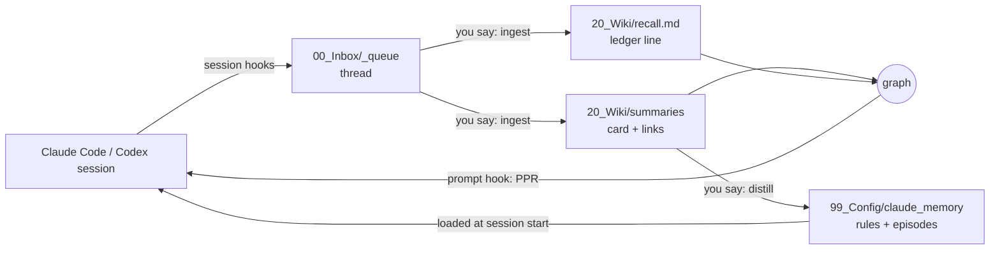

# Madeleine

**Associative memory for Claude Code.** Your conversations are saved, turned into cards, and linked into a graph. On every prompt, a hook finds the past conversations that the prompt touches and puts them in front of Claude. No embedding API, no vector database, no server: markdown files, git, and the Python standard library. An optional model learns from your own conversations on your machine; only its training step needs numpy and scipy.

[한국어](README.ko.md)

The name comes from Proust. In *In Search of Lost Time*, the taste of a madeleine dipped in tea brings back the narrator's childhood without any effort to remember. Here, too, you do not search your memory; the current conversation brings it up.

## What it looks like

From a demo vault of six made-up conversations, plus two queued ones not ingested yet. You type:

> the basil is going black again, should I change how often I water it?

Before Claude answers, the hook adds this to the context:

```
Recalled memories (injected automatically: conversations not yet ingested that overlap this prompt, then past conversations it touches. Each line is a memory that came to mind. [keyword], [model] and [raw] name the method that brought the line up. Keep them in the background; open the path or [[link]] when you need detail. If you Read a summary, run recall_ppr.py learn):
- (not ingested) 2026-08-02 pruning the tomatoes — "The tomato plants are taller than me. Should I cut the top?" · "And should I water less in August?" → 00_Inbox/_queue/2026-08-02_pruning_the_tomatoes__thread.md
- [keyword] 2026-03-20 [[2026-03-20_drip_timer_broke_basil_rot__summary|The drip timer broke and the basil started rotting]] — timer battery · overwatering · root rot · "the soil never dries out"
- [keyword] 2026-03-02 [[2026-03-02_balcony_vegetable_garden_plan__summary|Planning a vegetable garden on the balcony]] — tomato planters · south-facing balcony · drip irrigation · "too much shade by 3pm" · seed swap
- [keyword] 2026-06-01 [[2026-06-01_essay_why_i_garden__summary|Drafting an essay on why I garden]] — patience · "nothing happens for weeks" · first essay draft
- [keyword] 2026-07-15 [[2026-07-15_moving_to_a_north_facing_flat__summary|Deciding whether to move to a north-facing flat]] — lease renewal · north-facing windows · "I'd lose the balcony"
- [raw] 2026-05-08 [[2026-05-08_sourdough_starter_revival__summary|Reviving a sourdough starter after two weeks away]] — you said: "It doubled again on the second day." → 00_Inbox/_processed/2026-05-08_sourdough_starter_revival__thread.md:21
- [raw] 2026-04-11 [[2026-04-11_library_seed_swap__summary|Trading seeds at the library seed swap]] — you said: "The seed swap at the library was busy. The rule was take three, bring three." → 00_Inbox/_processed/2026-04-11_library_seed_swap__thread.md:13
```

The first line is a conversation not ingested yet; it shares the word "water" with the prompt. The essay card shares no word with the prompt; it came up through its link to the balcony card. `[raw]` lines come from comparing the raw text and point to the line where you said it. After you train the optional model, `[keyword]` keeps two lines and `[model]` adds two.

## What is different

- **Association, not search.** Recall runs Personalized PageRank (spreading activation) over a graph of conversation cards, the people, places, and projects in them, and the links between cards. The approach follows [HippoRAG](https://arxiv.org/abs/2405.14831).
- **Claude reads the files.** A card is YAML front matter; Claude opens it and follows its links. Every memory is a file you can read and edit.
- **Three ways to recall.** `[keyword]` spreads activation over the graph. `[raw]` compares character pieces of what you actually said. `[model]` uses vectors trained on your own conversations: exchanges that follow each other and cards you linked by hand. Recall runs on the Python standard library. Training is optional and needs numpy and scipy; until you train, `[keyword]` takes the model's place.
- **It learns from what gets used.** When Claude reads a recalled card, the edges that led to it get stronger (Hebbian learning, 90-day half-life). Cards that were only shown get nothing.
- **A separate mind layer.** Two kinds of files shape how Claude works with you: behavior rules it must follow, and `episodes.md`, moments when you decided something, quoted word for word. How you think is never written down as rules; Claude reads the events and judges.

## How it works



1. **Capture.** Session hooks save every session as a markdown thread in `00_Inbox/_queue/`. Tool calls and system text are dropped; your words and Claude's answers stay.
2. **Ingest.** Say `ingest`. Claude reads the thread and writes a card (claims, corrections, open questions, entities, decisive moments), one ledger line in `20_Wiki/recall.md` with the words that should bring it back later, and links to related past cards.
3. **Recall.** On every prompt, `recall_ppr.py hook` seeds the graph from ledger words, entity aliases, and the raw text of every thread, and runs PPR. With the raw-text index in `20_Wiki/.recall_raw/` (the hook builds it in the background the first time), it injects up to 6 cards, 2 from each of `[keyword]`, `[model]`, and `[raw]`; without a trained model, `[keyword]` takes 4. Without the index, it injects the top 5 ledger lines. Queued threads that share a word with the prompt come first, at most 2, with a few of your lines from each.
4. **Check.** Before an answer that states facts or judgments, Claude runs `recall_ppr.py precheck "<gist>"`, which prints up to 2 memories the answer touches that the prompt side did not show. In Claude Code, a Stop hook asks for this check once when an answer of 300 characters or more skipped it. The same hook appends to `20_Wiki/recall_use.tsv` which shown cards Claude opened (`used`) and which cards it opened without being shown (`missed`).
5. **Learn.** After Claude reads a recalled card, it runs `recall_ppr.py learn`, and the edges that led there get stronger.
6. **Train (optional).** In a terminal, run `uv run --no-project --python 3.12 --with numpy --with scipy python 99_Scripts/recall_ppr.py train`. It learns from your conversations and writes the model next to the index. Run it again to learn new connections. Between trainings, a rebuilt index gives new conversations vectors from what the model already learned.
7. **Distill.** Say `distill` now and then. Claude lists event candidates and behavior-rule candidates from recent cards. You keep or drop each one. The `mind-manager` agent writes what you keep, quoting the source thread.

## Measured

On the author's own vault (one person's conversations, January 2025 to November 2026), on an Intel Core i9-10910 with 32 GB of memory:

- 1,391 conversations, 33 MB of threads on disk
- Graph: 3,790 nodes (1,391 conversations and 2,399 entities), 49,029 edges
- Raw-text index: 9,569 exchanges, built in 18 seconds
- Hook time per prompt, end to end, with the index and no model: 1.1 to 1.2 seconds over 10 runs
- Training the optional model: 2.5 minutes, 2.3 GB peak memory
- Hook time per prompt with the trained model: 1.3 to 1.5 seconds over 10 runs
- Dependencies: the Python standard library for recall; numpy and scipy for training only

## Quick start

1. On GitHub, click **Use this template** and create a **private** repository. Do not fork: a fork of a public repository is public, and your conversations would end up in it.
2. Clone it and open it with Claude Code:
   ```bash
   git clone git@github.com:<you>/<your-vault>.git
   cd <your-vault>
   claude
   ```
   Accept the folder trust prompt so the hooks in `.claude/settings.json` can run.
3. Work as usual. A session is captured when it ends; anything missed is captured at the next start.
4. Say `ingest` to turn queued threads into cards. Recall works from the first card.

Do not add a `CLAUDE.md` at the root (for example with `/init`). While it exists, Claude Code does not read `AGENTS.md`; `lint.py` reports it.

Requirements: Claude Code 2.1.277 or later (it reads `AGENTS.md` when there is no `CLAUDE.md`) or Codex CLI, Python 3, git. Optional: [uv](https://docs.astral.sh/uv/) to train the model, [age](https://github.com/FiloSottile/age) for the encrypted store, [Obsidian](https://obsidian.md) for browsing.

## Commands

Say these to Claude inside the vault. `AGENTS.md` defines each one.

| Say | What happens |
| --- | --- |
| `ingest`, `process next` | The oldest queued thread becomes a card, a ledger line, and links |
| `process <file>` | The same for one thread |
| `distill` | Review recent cards for events and behavior rules worth keeping |
| `capture <rule>` | Write an approved behavior rule into the mind layer |
| `create entity <name>` | Create an entity page from the template |
| `lint the wiki` | Run the integrity checks in `lint.py` |
| `import <export.json>` | Import a claude.ai data export into the queue |

## Layout

```
AGENTS.md                  the operating manual Claude Code and Codex follow
00_Inbox/_queue/           captured threads waiting for ingest
00_Inbox/_processed/       threads after ingest (never edited)
20_Wiki/summaries/         one card per conversation (never edited, except links)
20_Wiki/recall.md          ledger: one line of recall words per card
20_Wiki/recall_cold.md     ledger lines unused for 180 days
20_Wiki/recall_hebbian.tsv learned edge weights (created by learn)
20_Wiki/recall_use.tsv     which recalled cards were opened (created by the Stop hook)
20_Wiki/.recall_raw/       raw-text index and optional model, per machine, not in git
20_Wiki/entities/          people, companies, projects
20_Wiki/threads/           hub notes for long-running topics
20_Wiki/log.md             one line per operation
99_Config/claude_memory/   mind layer: MEMORY.md index, episodes.md, rule notes
99_Config/prompts/         the card-writing prompt
99_Scripts/                hooks and tools
99_Style/voice.md          your writing voice, built up from your edits
90_Vaulted/                optional encrypted store for sensitive memory
30_Drafts/, 40_Published/  writing
```

## Privacy

- Everything stays in this folder as markdown. Nothing leaves your machine unless you push the repository. The hooks also keep small per-machine records in `~/.cache/madeleine/` (cards shown per session, precheck scores).
- The raw-text index and the model are derived from your threads and stay out of git. `vault_lock.py add` rebuilds the index so a conversation moved into the encrypted store leaves it.
- The hooks never commit or push. To use the vault on several devices, push to a private remote yourself.
- `vault_lock.py` keeps sensitive conversations in an `age`-encrypted container. While it is locked, recall, grep, and ingest do not see them. Run `unlock` and `lock` in a separate terminal, and never type the passphrase into a chat.
- `link_memory.sh` creates one symlink, `~/.claude/projects/<this folder>/memory`, so that Claude Code loads `MEMORY.md` at session start.

## Codex CLI

Run `codex` in the vault. Codex reads `AGENTS.md`. `.codex/hooks.json` loads `MEMORY.md`, captures sessions, and runs recall; Codex asks you to trust each hook the first time. The Stop-hook check and the use ledger run only in Claude Code. `.codex/agents/mind-manager.toml` provides the same agent.

## Design notes

- **Faithful capture.** Cards keep who said what and how sure they were. Your words stay verbatim, and AI phrasing is never recorded as yours.
- **Minimal process.** No tag taxonomy, no concept notes, no status fields. Depth comes from reading, not from procedure.
- **Ways of thinking are not rules.** A rule that names how you think makes Claude act out that rule. Events quoted verbatim let Claude work it out in context.

## License

MIT. See [LICENSE](LICENSE).
