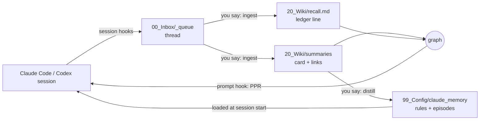

# Madeleine

**Associative memory for Claude Code.** Your conversations are saved, turned into cards, and linked into a graph. On every prompt, a hook finds the past conversations that the prompt touches and puts them in front of Claude. No embeddings, no vector database, no server: markdown files, git, and the Python standard library.

[한국어](README.ko.md)

The name comes from Proust. In *In Search of Lost Time*, the taste of a madeleine dipped in tea brings back the narrator's childhood without any effort to remember. Here, too, you do not search your memory; the current conversation brings it up.

## What it looks like

From a demo vault of six made-up conversations. You type:

> the basil is going black again, should I change how often I water it?

Before Claude answers, the hook adds this to the context:

```
Recalled memories (injected automatically: recent conversations not yet ingested, then past conversations this prompt touches). Each line is a memory that came to mind. Keep them in the background; open the path or [[link]] when you need detail. If you Read a summary, run recall_ppr.py learn:
- 2026-03-20 [[2026-03-20_drip_timer_broke_basil_rot__summary|The drip timer broke and the basil started rotting]] — timer battery · overwatering · root rot · "the soil never dries out"
- 2026-03-02 [[2026-03-02_balcony_vegetable_garden_plan__summary|Planning a vegetable garden on the balcony]] — tomato planters · south-facing balcony · drip irrigation · "too much shade by 3pm" · seed swap
- 2026-06-01 [[2026-06-01_essay_why_i_garden__summary|Drafting an essay on why I garden]] — patience · "nothing happens for weeks" · first essay draft
(3 more lines)
```

The third card shares no word with the prompt. It came up through its link to the balcony card.

## What is different

- **Association, not search.** Recall runs Personalized PageRank (spreading activation) over a graph of conversation cards, the people, places, and projects in them, and the links between cards. The approach follows [HippoRAG](https://arxiv.org/abs/2405.14831).
- **Claude reads the files.** Nothing is embedded. A card is YAML front matter; Claude opens it and follows its links. Every memory is a file you can read and edit.
- **It learns from what gets used.** When Claude reads a recalled card, the edges that led to it get stronger (Hebbian learning, 90-day half-life). Cards that were only shown get nothing.
- **A separate mind layer.** Two kinds of files shape how Claude works with you: behavior rules it must follow, and `episodes.md`, moments when you decided something, quoted word for word. How you think is never written down as rules; Claude reads the events and judges.

## How it works



1. **Capture.** Session hooks save every session as a markdown thread in `00_Inbox/_queue/`. Tool calls and system text are dropped; your words and Claude's answers stay.
2. **Ingest.** Say `ingest`. Claude reads the thread and writes a card (claims, corrections, open questions, entities, decisive moments), one ledger line in `20_Wiki/recall.md` with the words that should bring it back later, and links to related past cards.
3. **Recall.** On every prompt, `recall_ppr.py hook` seeds the graph from ledger words, entity aliases, and the raw text of every thread, runs PPR, and injects the top 10 ledger lines. Threads not ingested yet come first, with a few of your lines from each.
4. **Learn.** After Claude reads a recalled card, it runs `recall_ppr.py learn`, and the edges that led there get stronger.
5. **Distill.** Say `distill` now and then. Claude lists event candidates and behavior-rule candidates from recent cards. You keep or drop each one. The `mind-manager` agent writes what you keep, quoting the source thread.

## Measured

On the author's own vault (one person's conversations, January 2025 to October 2026), on an Intel Core i9-10910 with 32 GB of memory:

- 1,191 conversations, 26 MB of threads on disk
- Graph: 2,673 nodes (1,191 conversations and 1,482 entities), 17,319 edges
- Hook time per prompt, end to end: 0.9 to 1.6 seconds over 10 runs
- Dependencies: the Python standard library. Embedding and vector database cost: 0

## Quick start

1. On GitHub, click **Use this template** and create a **private** repository. Do not fork: a fork of a public repository is public, and your conversations would end up in it.
2. Clone it and open it with Claude Code:
   ```bash
   git clone git@github.com:<you>/<your-vault>.git
   cd <your-vault>
   claude
   ```
   Accept the folder trust prompt so the hooks in `.claude/settings.json` can run.
3. Work as usual. A session is captured when it ends; anything missed is captured at the next start.
4. Say `ingest` to turn queued threads into cards. Recall works from the first card.

Requirements: Claude Code or Codex CLI, Python 3, git. Optional: [age](https://github.com/FiloSottile/age) for the encrypted store, [Obsidian](https://obsidian.md) for browsing.

## Commands

Say these to Claude inside the vault. `CLAUDE.md` defines each one.

| Say | What happens |
| --- | --- |
| `ingest`, `process next` | The oldest queued thread becomes a card, a ledger line, and links |
| `process <file>` | The same for one thread |
| `distill` | Review recent cards for events and behavior rules worth keeping |
| `capture <rule>` | Write an approved behavior rule into the mind layer |
| `create entity <name>` | Create an entity page from the template |
| `lint the wiki` | Run the integrity checks in `lint.py` |
| `import <export.json>` | Import a claude.ai data export into the queue |

## Layout

```
CLAUDE.md                  the operating manual Claude follows
00_Inbox/_queue/           captured threads waiting for ingest
00_Inbox/_processed/       threads after ingest (never edited)
20_Wiki/summaries/         one card per conversation (never edited, except links)
20_Wiki/recall.md          ledger: one line of recall words per card
20_Wiki/recall_cold.md     ledger lines unused for 180 days
20_Wiki/entities/          people, companies, projects
20_Wiki/threads/           hub notes for long-running topics
20_Wiki/log.md             one line per operation
99_Config/claude_memory/   mind layer: MEMORY.md index, episodes.md, rule notes
99_Config/prompts/         the card-writing prompt
99_Scripts/                hooks and tools
99_Style/voice.md          your writing voice, built up from your edits
90_Vaulted/                optional encrypted store for sensitive memory
30_Drafts/, 40_Published/  writing
```

## Privacy

- Everything stays in this folder as markdown. Nothing leaves your machine unless you push the repository.
- The hooks never commit or push. To use the vault on several devices, push to a private remote yourself.
- `vault_lock.py` keeps sensitive conversations in an `age`-encrypted container. While it is locked, recall, grep, and ingest do not see them. Run `unlock` and `lock` in a separate terminal, and never type the passphrase into a chat.
- `link_memory.sh` creates one symlink, `~/.claude/projects/<this folder>/memory`, so that Claude Code loads `MEMORY.md` at session start.

## Codex CLI

Run `codex` in the vault. `.codex/config.toml` makes Codex read `CLAUDE.md`. `.codex/hooks.json` loads `MEMORY.md`, captures sessions, and runs recall; Codex asks you to trust each hook the first time. `.codex/agents/mind-manager.toml` provides the same agent.

## Design notes

- **Faithful capture.** Cards keep who said what and how sure they were. Your words stay verbatim, and AI phrasing is never recorded as yours.
- **Minimal process.** No tag taxonomy, no concept notes, no status fields. Depth comes from reading, not from procedure.
- **Ways of thinking are not rules.** A rule that names how you think makes Claude act out that rule. Events quoted verbatim let Claude work it out in context.

## License

MIT
